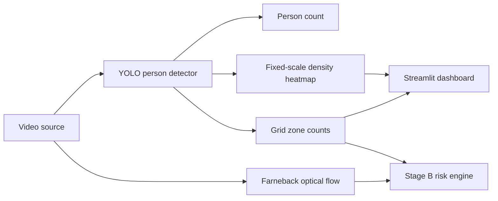

# CrowdShield AI

CrowdShield AI is a CPU-capable prototype for predicting crowd-safety risk
from video and triggering simulated on-site guidance. Stage B adds sampled
time-series analysis, Farneback optical flow, fixed-scale density, explainable
risk, cached multilingual voice alerts, and a dark command-center dashboard.

## Setup

Python 3.10+ is supported. From PowerShell:

```powershell
python -m venv .venv
.\.venv\Scripts\Activate.ps1
python -m pip install torch torchvision --index-url https://download.pytorch.org/whl/cpu
python -m pip install -r requirements.txt
streamlit run app.py
```

The app reads the existing `data/Crowd-Activity-All.avi` and optionally any
`.mp4` or `.avi` clips placed in `data/videos/`. Data is never moved or
modified. The first YOLO run downloads `yolov8n.pt`; it is cached by
Ultralytics and ignored by git. Click **Run demo** to precompute a sampled
time series with a progress bar; results and `outputs/risk_log.csv` come from
the selected real video.

Risk is computed after configured rolling smoothing and per-scene baseline
calibration. Farneback flow is computed between adjacent source frames while
YOLO runs at the configured dense analysis rate. Flow features are
presence-gated, and the dashboard uses seconds on its charts. Set `SCENE_STARTS_S` and
`PANIC_STARTS_S` in `src/config.py` to enable scene boundaries,
panic markers, lead-time validation, and the before/after validation panel.

## ShanghaiTech evaluation

```powershell
.\.venv\Scripts\python.exe -m src.evaluate
```

This writes `outputs/eval_results.csv` and prints MAE/MSE for Part A and Part B.
YOLO under-counts very dense crowds, so Part A is expected to have high error;
this is the motivation for the future density-estimation hook.

## Architecture



## Results

Results are generated only by real runs and are saved under `outputs/`.
No benchmark number is hardcoded.

## Screenshots

Add screenshots from the Streamlit dashboard here after running a local demo.

## Scope and limits

The prototype does not implement crowd-type profiles, venue assessment,
staffing or police logic, databases, FastAPI, LSTM forecasting, or
multi-camera ingestion. TODO extension points are kept in the source.
